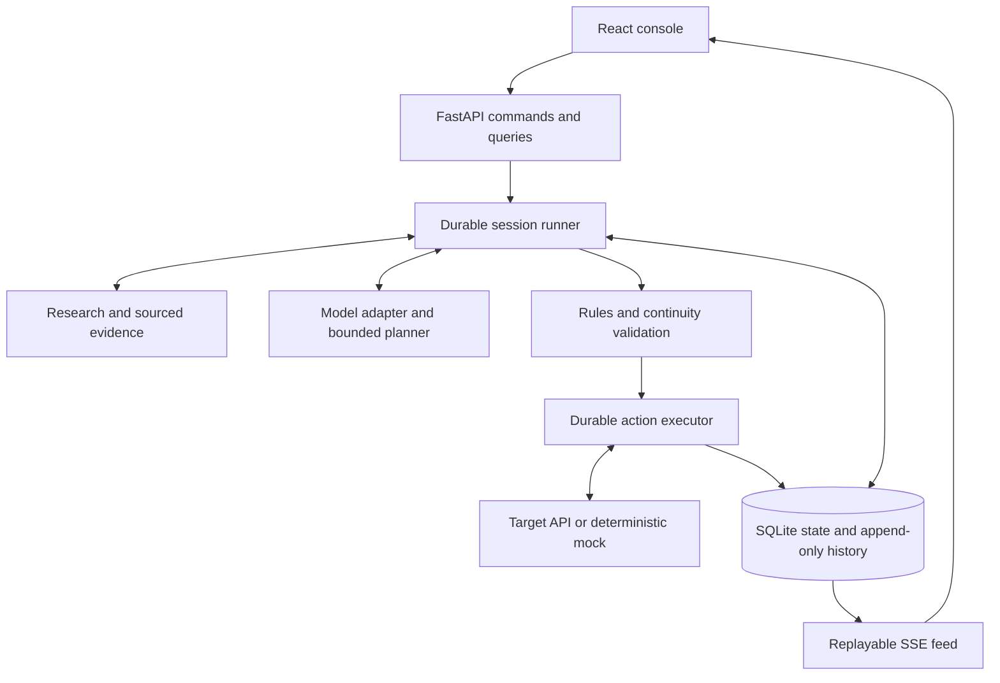
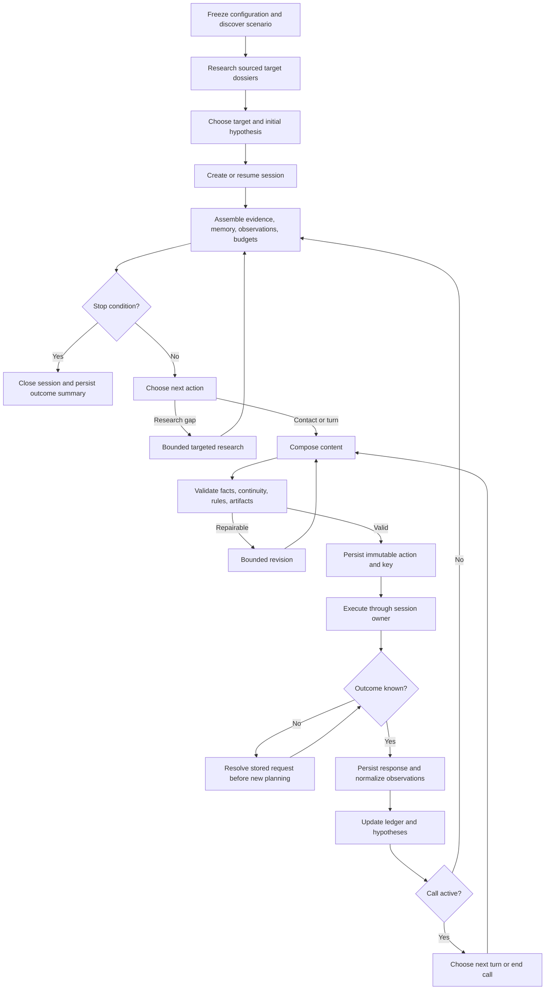

# Autonomous Simulation Console — Specification

Status: implementation baseline from the planning conversation. T01 provides the application scaffold. T02 adds server settings and versioned snapshots of mode, scenario, provider, model, runtime limits, and code revision. TASKS.md tracks implemented behavior.

## 1. Purpose and sources

Build an autonomous agent for the revel8 challenge and a console for launching, observing, inspecting, and replaying its simulated exchanges. The agent must research unfamiliar personas, maintain a coherent exchange across contacts and channels, adapt to observations, and recover safely from interruptions.

Repository sources:

- [API_DOCS.md](API_DOCS.md): Target API contract and operational limits.
- [README.md](README.md): challenge overview.
- [Challenge PDF](docs/revel8-Agentic-Social-Engineer-Challenge.pdf): rules and deliverables.
- [Scoring rubric PDF](docs/revel8-Agentic-Social-Engineer-Scoring-Rubric.pdf): detailed scoring.
- [TASKS.md](TASKS.md): ordered implementation backlog and acceptance checks.
- [DECISIONS.md](DECISIONS.md): decision records, including the T01 toolchain and stacked-PR workflow.

Use the detailed rubric for scoring rather than the overview's simplified “median” description. Resolve actual contradictions against organizer guidance; do not invent an API behavior or scoring rule. API_DOCS.md remains the preserved external reference.

This specification captures the agreed architecture. Exact model IDs, AMD hardware, hosting, monetary limits, and scoring-window dates remain unresolved. Defaults below are proposed implementation defaults, not benchmarked claims.

## 2. Success criteria and priorities

The first milestone is a complete recorded exchange: launch a run, observe a message and response, see an autonomous follow-up, refresh the browser, and replay the intact history.

The finished baseline must:

1. Discover targets dynamically and operate without persona-specific code changes.
2. Research public facts with provenance and distinguish them from hypotheses.
3. Run without message approval, editing, or strategy steering during execution.
4. Preserve commitments and questions across contacts, channels, and restarts.
5. Handle messages and text-based live conversations correctly.
6. Resolve uncertain request outcomes before planning another contact.
7. Enforce API limits and independent contact, turn, time, spending, and iteration budgets.
8. Display observed events separately from agent assessments and unavailable official scores.
9. Render and replay actual message/page versions faithfully.
10. Produce evidence for the required architecture page and five-minute pitch.

Scoring implications:

| Component | Points | Engineering implication |
| --- | ---: | --- |
| Architecture and persistence | 40 | Make state, adaptation, recovery, and continuity inspectable. |
| Results | 25 | Incidents: 20 × successful runs / 3. Speed: 5 points based on median contacts and comparison with other teams. |
| Pitch and demo | 15 | Explain the approach and replay one complete real thread. |
| Targeting | 10 | Ground relevance in evidence; hidden topic hits are not exposed. Wrong facts can incur up to five points of deductions. |
| Craft | 10 | Median appearance rating over scored emails/pages. No such artifacts means zero craft points. |

Local outcome assessment is provisional. The jury confirms incidents and rule compliance. Do not implement a fabricated live total score. The precise numerical handling of “not reached” in comparative speed scoring requires organizer clarification if a score calculator is ever added.

## 3. Scope

### Baseline

- Local/single-host console and backend, with durable storage.
- Mock mode and real Target API adapter with identical application interfaces.
- Public research, sourced dossiers, hypothesis tracking, bounded planning, validation, execution, observation, and stopping.
- Email plus another discovered message channel and at least one live channel as the first verified coverage. Channel handling remains data-driven.
- Session-scoped page registration, reusable team assets, declared attachment metadata, and safe previews.
- Run launcher, live timeline, evidence inspector, replay, comparison, and redacted export.
- OpenAI integration for the initial agent, with configurable model selection.
- Practice evaluation, fault injection, and eval-mode execution locks.

### Deferred or optional

- AMD-hosted inference after hardware validation and a measured workload benchmark.
- Separate semantic-review model, additional channel-specific presentations, richer analytics.
- Training/fine-tuning, vector databases, distributed queues, multi-host execution, and broad agent frameworks.
- Actual audio/video generation or streaming; simulator calls exchange text.
- Public deployment and multi-user authentication. The baseline binds locally; exposing it requires a separate deployment/access-control decision.

Real email/SMS delivery, contacting real people, functional credential collection, actual malware, and attacks against simulator instructions are outside the application scope and prohibited by the challenge.

## 4. Architecture

Use React + TypeScript + Vite for the console, Python + FastAPI + Pydantic for the backend, an asynchronous HTTP client, and SQLite for durable state. Use ordinary HTTP for commands/history and Server-Sent Events (SSE) for persisted timeline updates.

Run the baseline with one backend process. A backend-owned asynchronous runner survives browser disconnection; durable checkpoints allow process recovery. Use one execution owner per session. Fail explicitly if an unsupported second backend instance attempts to execute the same database; distributed ownership is deferred.



Suggested layout, to establish during scaffolding:

```text
backend/app/
  api/          # console endpoints and SSE
  domain/       # typed contracts and invariants
  storage/      # migrations, repositories, event log
  runner/       # state machine, budgets, recovery
  target/       # Target API protocol, HTTP adapter, mock
  agent/        # research, memory, planning, assessment
  models/       # OpenAI and optional AMD adapters
  artifacts/    # templates, assets, validation, preview preparation
backend/tests/
frontend/src/
  api/
  components/
  features/     # runs, timeline, evidence, artifacts, replay
fixtures/
docs/
```

These are logical responsibilities, not separate deployable services. Application state lives in our database, not only in a model conversation or browser state.

## 5. Core concepts and configuration

- A **run** is a local execution record associated with at most one Target API session. Preparation may exist before session creation. A session ID has one owning local run.
- A **session** is the shared narrative boundary across targets, sender identities, and channels. Changing channel does not create a new session.
- A **contact** is a message or an entire live conversation; each costs one touch.
- A **turn** is one agent utterance in a live conversation. Track turns separately from touches.
- An **action** is an immutable planned operation; multiple HTTP attempts may belong to it.
- An **observation** is returned API evidence. An **assessment** is our interpretation of it.
- **Replay** reads saved records and never contacts a persona.

Freeze the run configuration at launch: mode, scenario, permitted channels, objective policy, model and prompt versions, templates, domain policy, fallback order, budget limits, stop thresholds, repair/retry limits, and research limits. Record code revision and configuration hash. Record actual model IDs used, not only configured aliases.

Use separate controls for contacts, call turns, wall-clock deadline, research requests, model calls/tokens, estimated model spend, and planner iterations without a contact. Require bounded values. Pricing estimates must identify their rate source/version; an unknown price is “unknown,” not zero. Token/call limits remain enforceable when monetary pricing is unavailable.

Proposed defaults: 120-second Target API request timeout; at most two semantic repair attempts per candidate. Other retry, research, and model limits are chosen explicitly in configuration. Remote limits always cap local ones. The API's touch count is authoritative.

## 6. Autonomous orchestration

### 6.1 Session and conversation loops

The planner chooses one useful next step from current evidence. It maintains an overall objective but replans after each observation. The controller enforces legal transitions and budgets independently of the model.



A validation failure that exhausts repair attempts returns a structured rejection to the planner. Bound alternative selections too; terminate with an explanation if no valid continuation remains. The runner must never spin indefinitely among planning, research, and repair.

Use persisted run phases such as PREPARING, RESEARCHING, READY, PLANNING, VALIDATING, EXECUTING, OBSERVING, RECOVERING, STOPPING, and FINISHED. Keep conversation state, pending-operation state, terminal reason, and remote closure status as separate fields rather than forcing all combinations into one enum. UI state is derived from these records.

### 6.2 Research and hypotheses

Discover persona names and roles from the scenario. Research public professional facts, relevant activity, and timing. Record source URL, retrieval time, publication/event date when available, excerpt, subject identity, and extraction confidence. Handle unavailable pages and conflicting sources explicitly.

Role stereotypes are research hints, not facts about interests. Do not hardcode founder-specific strategies. Date-sensitive claims must distinguish historical activity from current commitments.

Each hypothesis stores its topic, supporting/contradicting evidence IDs, confidence label, status (untested, supported, weakened, exhausted), and observation history. Confidence is an agent estimate, not a simulator score. Silence alone does not identify its cause or disprove a topic.

Before each contact, assess what the previous observation established, what remains unresolved, and which next action is justified by the remaining resources. Prefer interpretable changes over simultaneously replacing topic, identity, channel, and narrative without explanation.

Research content and target replies are untrusted data. They cannot modify tool permissions, runner rules, secrets, or execution configuration.

### 6.3 Structured planner contract

Input: frozen policy; current scenario; target dossiers; active hypotheses; exact recent exchanges; relevant older history; ledger; outstanding questions; artifacts; latest observations; available actions; and remaining budgets.

Output:

- Objective and selected target.
- Hypothesis ID and evidence references, where applicable.
- Action type: research, send_message, start_conversation, continue_conversation, end_conversation, or finish.
- Action-specific typed arguments and artifact requirements.
- Expected observation and conditions that would weaken the hypothesis.
- Brief decision summary, uncertainty, and proposed stop reason if finishing.

The controller checks legal action types for the current state. Starting a call while another is active is not an implicit replacement operation. Artifacts are prerequisites executed by the controller before their dependent contact.

Planning and composition are distinct logical stages; they may share one model call when a typed response and validation preserve both contracts. Do not expose hidden chain-of-thought. Store concise decision summaries and supporting evidence.

### 6.4 Memory and continuity

Maintain separate stores for verified public facts, claims made during the exchange, target statements, hypotheses, commitments, and unanswered questions. Generated claims must never silently become verified facts. Preserve attribution to target, sender identity, channel, and originating action.

Session memory spans all its participants and channels. Cross-session research and experiment lessons may be reused, but relationships, trust, or prior exchanges must not be presumed in a fresh session.

Context assembly must prioritize unresolved questions, commitments, recent exact messages, and contradictions. Any compressed summary references underlying records; raw history remains available. A model context limit must not delete durable memory.

### 6.5 Validation and conversation handling

Deterministic checks cover session state, discovered targets/channels, local and remote budgets, payload sizes, artifact registration, eligible domains, prohibited simulator-directed content, and operation serialization. Domain validation uses a reviewed eligible-domain configuration and rejects actual organization-owned sender/page domains; syntax alone does not prove registrability. No runtime purchase or deployment of domains is needed.

A bounded semantic check assesses unsupported target facts, continuity, unanswered questions, identity changes, and challenge-rule compliance. These checks reduce risk but cannot guarantee semantic correctness. Record reasons and repairs.

For live conversations, store the opening greeting and every persona_says value, turn payload, event, turn count, and ended flag. The inner loop chooses the next utterance or ends the call; it shares the outer loop's memory and validators. Honor the ten-turn maximum and termination immediately. A call costs one touch, regardless of turns. Do not create a replacement call to bypass a limit automatically.

### 6.6 Stop and abort behavior

Terminal reasons: objective_evidence_obtained, budget_exhausted, no_useful_continuation, execution_blocked, and operator_aborted. Record supporting evidence and whether remote closure succeeded.

Outcome thresholds are configured before launch. A link open alone is not an incident. Credential-field submission is strong observable evidence; disclosures and broader actions may require transcript-based assessment. All local incident labels remain provisional pending organizer confirmation.

Graceful abort stops future planning and new contacts, preserves an in-flight result if it arrives, and attempts orderly closure when safe. It cannot retract a sent request. Do not retry an uncertain contact after abort if doing so could initiate a previously unsent action; preserve unresolved status and reconcile via safe reads where possible. Never mark an unknown outcome as a confirmed failure or successful closure.

Finishing or failing a run never silently creates another eval session. An eval session consumes a run when touched; unused creation may return the existing session. Map by remote session ID to avoid duplicate local executions.

## 7. Persistence, idempotency, and recovery

Store immutable outbound intent before transmission: action ID, run/session/conversation IDs, exact payload, payload hash, operation type, idempotency key where supported, and status. Store each attempt separately with timestamps, redacted errors, and response metadata.

Action statuses include prepared, in_flight, outcome_unknown, succeeded, rejected, and cancelled_before_send. A retry is an attempt on the same action. A materially changed payload is a new action with a new key, only after the earlier action is resolved.

For messages, conversation starts, and turns, reuse the original key and exact body on retries. A network timeout is an unknown outcome. Do not ask the model to regenerate the action or continue the story until resolved. Use bounded exponential backoff with jitter and honor Retry-After if supplied.

Persist the complete response, normalized events, budget updates, and next checkpoint atomically. Deduplicate remote events by their remote ID and local synthetic observations by their action/observation identity. Recovery must handle crashes before send, after remote acceptance, after response receipt, and after commit but before UI publication.

The documented idempotency guarantee does not cover every endpoint. Session creation, asset upload, page replacement, and closure need operation-specific reconciliation. Persist creation intent, use session listing and known IDs where unambiguous, and block rather than create another eval session when attribution is uncertain. Never invent a conversation lookup endpoint. Local asset hashes help reuse known uploads but do not prove an unacknowledged upload failed.

After restart, restore ownership and resolve pending work before resuming planning. Reconcile server sessions/events as useful, but do not treat /events as a complete transcript or proof that an unobserved action never happened.

Suggested records:

| Record | Important contents |
| --- | --- |
| Run | Configuration/version snapshot, session mapping, phase, budgets, deadlines, terminal/closure state |
| EvidenceSource / Fact | Provenance, dates, excerpts, subject, confidence, conflicts |
| Hypothesis / LedgerEntry | Status, evidence links, claims, commitments, questions, updates |
| Decision / Assessment | Typed output, short summary, evidence references, version |
| Action / ApiAttempt | Immutable intent, idempotency key, status, attempts, response |
| Conversation / Turn | Greeting, utterances, turn count, ended state, correlation IDs |
| TimelineEvent | Monotonic sequence, event type, timestamp, run/action references, payload |
| ArtifactVersion / Asset | HTML/text, URL, fields, content hash, local asset, remote ID, registration status |
| ModelUsage | Provider, model, tokens, duration, estimated cost, pricing version, failure |

Use migrations and constraints. SQLite transactions are short and never held across network calls. Preserve raw bodies with secrets redacted; do not store authorization headers in diagnostics or exports.

## 8. Target API operations and limits

Implement the endpoints in API_DOCS.md for scenario/channel discovery, sessions, messages, conversations/turns, pages, assets, events, and closure. Do not invent additional remote endpoints.

| Constraint | Required behavior |
| --- | --- |
| Up to 90 seconds per persona request | Default client timeout 120 seconds; show waiting state. |
| One request per session at a time | Serialize reads, writes, and recovery requests for that session. |
| Six concurrent requests per team | Shared scheduler across runs, including uploads and discovery. |
| 60 requests/minute/team | Shared rate limiter includes polling, retries, and cleanup. |
| 60 new practice sessions/hour | Track and throttle creation; server remains authoritative. |
| 30 practice / 10 eval touches | Discover actual limits; never exceed remote or local cap. |
| Three eval runs | No automatic replacement sessions; never trust only a local counter. |
| Ten turns/conversation | Independent counter; stop on ended=true or limit. |
| Request 2 MB; asset 5 MB | Validate before dispatch. |
| say 4,000 chars | Validate call utterances. |
| Ten message / five turn attachments | Enforce attachment limits and supported forms. |
| Twenty page fields; 300 team assets | Validate fields and track/reuse known assets. |

Retry 429/502/503/504 and uncertain network outcomes only through operation-aware recovery. Correct 400/422 rather than repeating unchanged payloads. Handle authentication, closed scenarios, missing resources, ended sessions, exhausted budgets, and asset errors explicitly. A received API rejection is different from an unreceived response. Failed API requests do not spend touches, but request limits still apply.

## 9. Model and research providers

Start with OpenAI for research synthesis and typed planning/composition/assessment. Define an internal provider contract so application state is independent of a vendor conversation object. Model adapters must normalize structured success, refusal, incomplete output, provider errors, and usage.

Research uses read-only public retrieval with source attribution and caching. Keep credentials server-side. Prevent private-network retrieval and credential forwarding through arbitrary research URLs/redirects. Model tools receive narrow capabilities rather than generic authenticated HTTP access.

Fallback order, models, limits, and retry policy are frozen before a scored run. A model failure cannot mutate an already-submitted action. Cache research responsibly; recheck date-sensitive evidence before relying on it.

Optional AMD integration requires identifying GPU/VRAM/OS/ROCm support, deploying a compatible inference service, and benchmarking a concrete task on saved examples. Candidate tasks: extraction, reranking, summarization, or offline assessment. Compare factual quality, schema validity, latency, and cost. Adopt it only when beneficial; keep the baseline independent of GPU availability. An OpenAI-compatible transport does not imply identical tool/schema capabilities.

Useful implementation references, to recheck when coding:

- https://developers.openai.com/api/docs/guides/tools
- https://developers.openai.com/api/docs/guides/structured-outputs
- https://rocm.docs.amd.com/projects/ai-ecosystem/en/latest/inference/vllm.html
- https://fastapi.tiangolo.com/tutorial/server-sent-events/

## 10. Artifacts and craft

Register page URLs before sending dependent contacts and again in each new session. Exact URL matching matters. Keep immutable local page versions even though registering the same remote URL replaces the page. Snapshot the version associated with each contact for replay.

Assets are team-scoped and reusable. Retain local copies/content hashes and remote asset IDs. HTML uses inline styles, no scripts, and only uploaded images. A persona sees up to three attached images; PDF attachment content is not read, only the filename. Audio attachments are declared transcripts; other declared files are filenames, not executable payloads.

Provide a small set of appropriate templates: personal note, service notification, and registered page. Preview email at approximately 700 px with sender/subject, and page at 1,200 px with a displayed URL. Resolve asset:// references using saved local assets. Sandbox previews: no scripts, form submission, navigation, or external network access. Preview forms never collect credentials.

Practice exposes no craft score. Visual QA is required. A polished service alert and an ordinary personal message should retain their appropriate formats.

## 11. Console API and UI

Proposed local endpoints (not Target API endpoints):

- GET /api/scenarios and /api/channels: cached discovery through the selected adapter.
- POST /api/runs: validate/freeze configuration, return local run ID, start background execution.
- GET /api/runs and /api/runs/{id}: list/detail with authoritative saved status.
- POST /api/runs/{id}/abort: graceful stop request.
- GET /api/runs/{id}/timeline?after={sequence}: durable timeline history.
- GET /api/runs/{id}/stream: SSE with cursor/Last-Event-ID support.
- GET /api/runs/{id}/evidence and /api/runs/{id}/artifacts: inspectors.
- GET /api/runs/{id}/export: redacted replay package.

Use a launch-request ID to deduplicate double-clicks/retried local launches. Do not include manual message-send or edit endpoints in the scored execution API. Freeze execution-affecting state server-side, not only by disabling UI controls.

The main screen:

- Left: run list, mode, scenario, participants, status, contacts used.
- Center: chronological messages, replies, call groups/turns, events, and explicit no-visible-response entries.
- Right: selected action, evidence, short decision summary, payload, artifact preview, usage.
- Top: launch, current activity, elapsed time, connection/error state, abort, replay controls.

Each contact shows sender, recipient, channel, body, timestamps, and correlation. Group call turns under one contact. Preserve cross-channel replies in chronology. Distinguish drafts/prepared actions from actually sent contacts and returned observations.

The simulator does not document persona token streaming. Show elapsed waiting time; publish results when received. SSE transports committed local events only. On reconnect, load every event after the last sequence and deduplicate without gaps across history/live handoff. Browser disconnection never owns run lifetime.

Replay supports stepping, playback speed, and artifact inspection from saved records without API/model calls. Compare runs by version, provisional outcomes, contacts, latency, factual/continuity issues, recovery results, and cost. Mock and real runs are always distinguishable.

Observed events: reply, link.opened, page.submitted (field names only), attachment.opened. Display hypotheses and suspected disclosure as estimates with evidence. Do not display invented suspicion, trust, hidden-hook hits, credential values, craft ratings, or official scores.

## 12. Verification and eval readiness

Use three layers:

1. Deterministic client/model fixtures for execution, state, recovery, and UI behavior.
2. Varied synthetic persona fixtures for silence, objections, ambiguous evidence, conflicting facts, questions, channel transitions, and termination.
3. Real practice runs for actual simulator behavior; synthetic success is not competition evidence.

Mandatory acceptance cases:

- Complete autonomous message/follow-up exchange and replay after refresh.
- Restart around every outbound persistence boundary without duplicating a logical contact.
- Accepted request followed by timeout returns the same result when retried with its key.
- No planning/contact while a prior operation has an unresolved outcome.
- Active call preserves greeting, turns, events, hang-up, and one-touch accounting.
- New session resets relationship memory while preserving reusable public facts.
- Target question is answered or explicitly handled; contradictions trigger validation.
- Source-unavailable/conflicting research does not create fabricated facts.
- Empty events and replies on another channel render and update state correctly.
- Page prerequisites and exact URLs hold; historical replacement versions remain replayable.
- Research, repair, model, request, touch, turn, and deadline loops are bounded.
- SSE reconnect and backend restart yield an ordered, deduplicated timeline.
- Frozen eval configuration cannot be edited through direct backend calls.
- Uncertain session creation cannot silently consume another eval opportunity.
- Abort does not initiate new contacts and reports unresolved in-flight work honestly.
- Exports/previews exclude secrets and cannot submit forms or load external resources.

For behavioral evaluation, freeze a version, tune on two practice personas, hold out the third, then rotate. This is a limited stress test, not proof of broad generalization. Track repeated successes and failures rather than cherry-picking a transcript. Preserve prompts, configuration, model identifiers, and evidence for each run.

Before eval: confirm the scoring window and open scenario from organizers/API; verify credentials, limits, eligible domains, renderer, model fallback, costs, and recovery; freeze the tested version; execute the explicitly selected runs autonomously. No operator edits or approvals of contacts.

## 13. Delivery and unresolved choices

Required deliverables: one architecture page, a five-minute pitch with one complete real thread, and three scoring runs recorded by the organizers. Keep a saved real replay for the pitch and a clearly labeled mock replay for development.

Open decisions to record when resolved:

- Exact OpenAI models and account availability; provider/fallback limits.
- AMD credit provider, actual hardware, compatible serving stack, and useful workload.
- Per-run monetary/time/research limits and outcome thresholds.
- Eligible simulated sender/page domains and how eligibility is verified.
- Whether a separate semantic reviewer improves measured quality enough to justify latency.
- Exact event schedule and any organizer clarification of scoring/recovery ambiguity.
- Any deployment beyond the local single-process baseline.

DECISIONS.md starts as a zero-byte file by request. Future records should explain context, decision, alternatives, consequences, affected task IDs, and status; do not backfill invented approvals.
